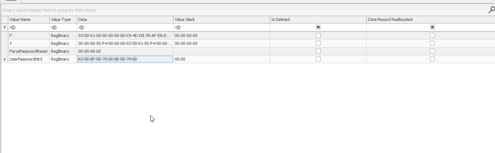
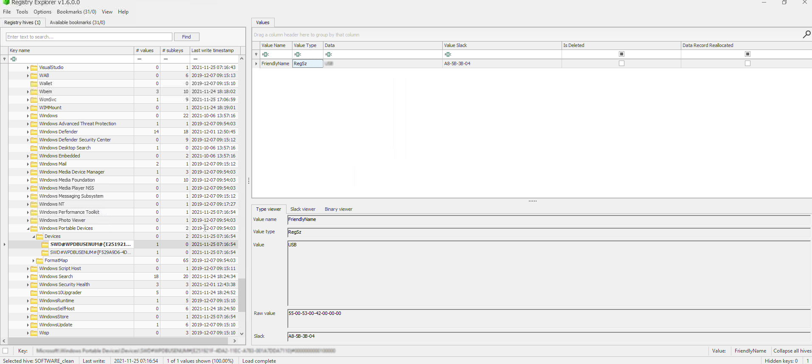
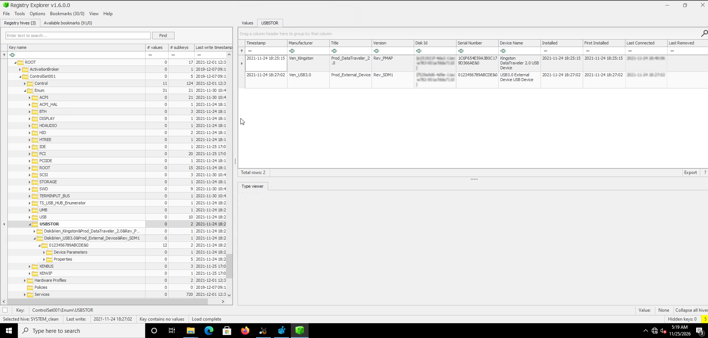
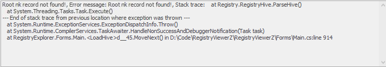

# Windows Registry Forensics: Offline Hive Analysis with Registry Explorer

I investigated a suspected unauthorized-access case on a Windows 10 research-lab desktop. The only evidence was a triage copy of the system's registry hives (SAM, NTUSER.DAT, SOFTWARE and SYSTEM). Working in TryHackMe's *Windows Forensics 1* room, I replayed transaction logs to build clean hives. From those I identified user-created accounts by RID and decoded a password hint stored as UTF-16LE bytes. I recovered when a text file was opened from RecentDocs, and traced where a software installer was launched from using UserAssist. Finally, I identified which USB device carried a given friendly name by linking its volume GUID across the SOFTWARE and SYSTEM hives, then read its last-connected time.

*IS 3033 Operating Systems Security · UT San Antonio · Fall 2026*

---

## Environment

| Item | Detail |
|---|---|
| Platform | TryHackMe in-browser Windows VM ([Windows Forensics 1](https://tryhackme.com/room/windowsforensics1)) |
| Evidence | Triage copy of a Windows 10 system's registry hives plus their `.LOG1` / `.LOG2` transaction logs |
| Primary tool | Registry Explorer v1.6.0.0 (Eric Zimmerman tools) |
| Also tried | Autopsy 4.19.3 (could not read the hive; see Troubleshooting) |
| Decoding | By hand (hex → decimal, UTF-16LE → ASCII), Windows Calculator Programmer mode |

---

## What I analyzed

| # | Artifact | Investigative purpose | Verified by |
|---|---|---|---|
| 1 | Transaction log replay (`.LOG1` / `.LOG2`) | Include changes not yet written to the primary hive file | Clean hive saved and loaded with no dirty-hive warning |
| 2 | `SAM\Domains\Account\Users` | Count user-created accounts (RID 1000 or higher) vs. built-in accounts (500–504) | Converted hex key names to decimal RIDs; cross-checked the `Names` subkeys |
| 3 | `UserPasswordHint` value in a user's SAM key | Recover the password hint for an account | Decoded the UTF-16LE bytes by hand with an ASCII table |
| 4 | `NTUSER.DAT\...\Explorer\RecentDocs\.txt` | Find when a specific text file was opened | Key LastWrite time, which belongs to the MRU position 0 entry |
| 5 | `NTUSER.DAT\...\Explorer\UserAssist\{CEBFF5CD-...}\Count` | Find the full path an installer was run from | ROT13-decoded program names, plus a keyword search for `python` |
| 6 | `SOFTWARE\Microsoft\Windows Portable Devices\Devices` | Map a device's friendly name to its volume GUID | `FriendlyName` value on the device key |
| 7 | `SYSTEM\ControlSet001\Enum\USBSTOR` + `Properties\{83da6326-...}\0066` | Last time that device was connected | USBSTOR Disk Id matched the volume GUID from step 6; both devices on the system cross-checked |





---

## Key registry paths

All paths are relative to the hive root as loaded in Registry Explorer (offline hives use `ControlSet001`, not `CurrentControlSet`).

### Accounts (SAM)
```text
SAM\Domains\Account\Users\<RID in hex>     # e.g. 000001F4 = 500, 000003E9 = 1001
SAM\Domains\Account\Users\Names\<username>
```

### File knowledge and execution (NTUSER.DAT)
```text
Software\Microsoft\Windows\CurrentVersion\Explorer\RecentDocs\.txt
Software\Microsoft\Windows\CurrentVersion\Explorer\UserAssist\{CEBFF5CD-ACE2-4F4F-9178-9926F41749EA}\Count   # executables
Software\Microsoft\Windows\CurrentVersion\Explorer\UserAssist\{F4E57C4B-2036-45F0-A9AB-650BAE0CCEC4}\Count   # shortcuts (.lnk)
```

### USB devices (SOFTWARE, then SYSTEM)
```text
SOFTWARE: Microsoft\Windows Portable Devices\Devices\<device key>          # FriendlyName + volume GUID in key name
SYSTEM:   MountedDevices                                                    # \??\Volume{GUID} -> device path
SYSTEM:   ControlSet001\Enum\USBSTOR\Disk&Ven_..&Prod_..&Rev_..\<serial>    # device history (NOT Control\usbstor)
SYSTEM:   ...\<serial>\Properties\{83da6326-97a6-4088-9453-a1923f573b29}\0064   # first connected
                                                                         \0066   # last connected
                                                                         \0067   # last removed
SYSTEM:   Select\Current                                                    # which ControlSet00x was active
```

### Optional helpers to reproduce the conversions
These aren't required. Registry Explorer decodes all of this itself; the helpers show the math.
```powershell
# Hex RID key name -> decimal RID
[Convert]::ToInt32('3E9', 16)          # 1001

# UTF-16LE bytes -> text (each character is 2 bytes; second byte is 00 for plain English)
[System.Text.Encoding]::Unicode.GetString([byte[]](0x48,0x00,0x69,0x00))   # "Hi"
```

---

## Results

- Built clean, log-merged copies of the SAM, NTUSER.DAT, SOFTWARE and SYSTEM hives from the triage data.
- Separated built-in accounts (RIDs 500, 501, 503, 504) from user-created accounts (RID 1000 and up).
- Recovered an account's password hint and identified an account with no recorded logins.
- Determined when a specific `.txt` file was last opened, and the full path an installer was launched from.
- Linked a USB device's friendly name to its hardware record by matching the volume GUID across two hives, and read its last-connected time.

Specific answers are left out to respect TryHackMe's no-spoilers expectation.

---

## Troubleshooting and lessons learned

| Problem | Cause | Fix |
|---|---|---|
| Autopsy showed the SAM file with all-zero timestamps and "offset 0-16,384 could not be read" | The file contents couldn't be read. Windows locks its live hives while running, and the evidence to use was the triage copy anyway. | Switched to Registry Explorer and loaded the SAM from the triage folder |
| SAM file "missing" from the open dialog | I had opened **regedit's** File → Import, which filters to `*.reg`. Hive files have no extension. | Closed regedit and used Registry Explorer's File → Load hive |
| Couldn't find the RID values | RIDs are the **hex key names** under `Users` (`000003E9`) | Converted hex → decimal; RID ≥ 1000 = user-created (1000 = `3E8` in hex) |
| Password hint showed as `xx-00-xx-00-...` bytes | Windows stores text as **UTF-16LE**: 2 bytes per character, low byte first | Dropped the `00` bytes and looked up each byte in an ASCII table |
| "Root nk record not found" when loading a hive | Registry Explorer read the header but found no root key (`nk` record) at the offset the header gave, so the selected file wasn't a complete hive | Rechecked that I picked the primary hive (not a `.LOG`, `.sav` or RegBack file) from the triage folder and reloaded |



| `usbstor` key showed only `DeviceHackFlags` and no serial numbers | I was in `Control\usbstor`, which holds **driver compatibility settings** that ship with Windows | Moved to `Enum\USBSTOR`, which only records devices actually connected |
| SOFTWARE device key had no serial number | Newer Windows 10 builds name these keys by **volume GUID** (`SWD#WPDBUSENUM#{GUID}#...`) | Matched the GUID to the **Disk Id** column in USBSTOR |
| On one load I declined log replay and cancelled the save dialog | The hive loaded **dirty**, without the transaction logs merged | Recorded that values from that load may be stale; the reliable path is to replay the logs and analyze the clean hive |

**Takeaways**

- **Use the right copy and the right tool.** Live hives are locked and the triage copy is the evidence. Registry Explorer handles offline hives, and regedit isn't built for that job.
- **Replay the transaction logs.** Recent changes can exist only in `.LOG1` / `.LOG2`. Skipping the replay can leave you analyzing stale data.
- **Registry data is often encoded.** Hex key names, UTF-16LE strings and ROT13 program names all need decoding, so knowing the encoding lets you read raw values when a plugin doesn't.
- **Same name, different meaning.** `Control\usbstor` and `Enum\USBSTOR` look alike but hold different data. Check the full key path before drawing conclusions.
- **Correlate across hives.** No single key tells the whole USB story. One shared identifier (the volume GUID) tied the friendly name in SOFTWARE to the hardware record and timestamps in SYSTEM.

---

## Skills demonstrated

- Offline Windows registry analysis with Registry Explorer (SAM, NTUSER.DAT, SOFTWARE, SYSTEM)
- Handling dirty hives and replaying transaction logs
- Account analysis with SIDs and RIDs (built-in vs. user-created)
- Manual data decoding: hexadecimal, UTF-16LE / ASCII, ROT13
- File-knowledge and evidence-of-execution artifacts (RecentDocs, UserAssist)
- USB device forensics and cross-hive correlation by volume GUID
- Interpreting registry key LastWrite timestamps
- Troubleshooting forensic tool errors

---

## References

- [Windows Forensics 1, TryHackMe](https://tryhackme.com/room/windowsforensics1)
- [Registry Hives, Microsoft Learn](https://learn.microsoft.com/en-us/windows/win32/sysinfo/registry-hives)
- [Well-known SIDs, Microsoft Learn](https://learn.microsoft.com/en-us/windows/win32/secauthz/well-known-sids)
- [Local Accounts (Administrator RID 500, DefaultAccount), Microsoft Learn](https://learn.microsoft.com/en-us/windows/security/identity-protection/access-control/local-accounts)
- [Digging Up the Past: Windows Registry Forensics Revisited (transaction logs), Google Cloud / Mandiant](https://cloud.google.com/blog/topics/threat-intelligence/digging-up-the-past-windows-registry-forensics-revisited)
- [The Windows Registry Adventure #5: The regf file format, Google Project Zero (Dec 2024)](https://projectzero.google/2024/12/the-windows-registry-adventure-5-regf.html)
- [Windows NT Registry File (REGF) format, libyal/libregf](https://github.com/libyal/libregf)
- [ROT13 is used in Windows? You're joking!, Didier Stevens (2006)](https://blog.didierstevens.com/2006/07/24/rot13-is-used-in-windows-you%E2%80%99re-joking/)
- [UserAssist tool, Didier Stevens](https://blog.didierstevens.com/programs/userassist/)
- [Identifiers generated by Usbstor.sys, Microsoft Learn](https://learn.microsoft.com/en-us/windows-hardware/drivers/install/identifiers-generated-by-usbstor-sys)
- [Eric Zimmerman's tools](https://ericzimmerman.github.io/)
